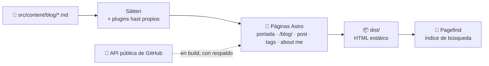

<div align="center">

```
~/flaviooria $ cat README.md
```

# flaviooria · blog

**Construyo, despliego y te lo cuento.**

Un cuaderno de bitácora sobre lo que monto, rompo y arreglo: backends en Python,
agentes de IA e infraestructura self-hosted. Escrito dentro de una sesión de
terminal, en Dracula 🦇 (oscuro) y Alucard ☀️ (claro).


</div>

---

## ✨ Qué tiene de especial

| Qué                                  | Cómo                                                                                                                                                                        |
| ------------------------------------ | --------------------------------------------------------------------------------------------------------------------------------------------------------------------------- |
| 🐚 **Estética de shell, no disfraz** | Rutas `~/blog $ ls -t` como cabecera, rótulos `// sección` como comentarios y `#` / `##` delante de cada título. Legibilidad ante todo: sin efectos CRT ni texto fosforito. |
| 📓 **Portada como bitácora**         | Entradas fechadas `AAAA-MM-DD` con minutos de lectura, capítulos y tags. `/blog/` es el archivo completo, agrupado por año.                                                 |
| 🌳 **Índice como `tree`**            | Carpetas por capítulo, hojas por sección y resumen final. Se despliega al pasar el ratón por el borde y se puede fijar con la chincheta 📌.                                 |
| 💬 **Callouts con nivel**            | Nota, info, aviso, precaución y error, cada uno con su icono y color, a partir de la sintaxis de GitHub (`> [!NOTE]`).                                                      |
| 🔎 **Búsqueda instantánea**          | Índice estático de Pagefind y modal propio con <kbd>⌘K</kbd> / <kbd>/</kbd>. Sin servidor.                                                                                  |
| 🌗 **Dos temas de primera**          | Sigue al sistema y se cambia a mano. El resaltado de código cambia con el tema (Shiki con variables CSS).                                                                   |
| 🫧 **Brillo ambiental**              | Un círculo difuminado con la paleta que rebota por la ventana como el salvapantallas del DVD. Quieto si pides menos movimiento.                                             |
| 🐙 **Datos de GitHub en build**      | "About me" muestra repos y proyectos públicos leídos en build, con respaldo si la API falla.                                                                                |
| ♿ **Accesible**                     | Contraste AA en los dos temas, landmarks, foco visible, `reduced-motion` respetado y objetivos táctiles de 44px.                                                            |

## 🎨 Paleta

Cada acento significa **una sola cosa** (The One Role Rule):

| Rol                                          | Dracula 🦇 | Alucard ☀️ |
| -------------------------------------------- | ---------- | ---------- |
| Fondo                                        | `#282a36`  | `#fffbeb`  |
| Tinta                                        | `#f8f8f2`  | `#1f1f1f`  |
| 💜 Marca: títulos, botón principal           | `#bd93f9`  | `#644ac9`  |
| 🩷 "Estás aquí": foco, hover, sección activa | `#ff79c6`  | `#a3144d`  |
| 🩵 Enlaces y tags                            | `#8be9fd`  | `#036a96`  |
| 💚 Salida de la shell: marca `~/flaviooria`  | `#50fa7b`  | `#14710a`  |
| 🧡 Aviso y énfasis                           | `#ffb86c`  | `#a34d14`  |
| 💬 Comentarios `//`, fechas                  | `#8390c0`  | `#6c664b`  |

Tipografía: **IBM Plex Sans** para leer y **Fira Code** para todo lo que "imprimiría" la shell.
El sistema completo está en [`DESIGN.md`](DESIGN.md).

## 🚀 Arrancar

```sh
npm install
npm run dev        # http://localhost:4321
```

```sh
npm run build      # genera ./dist y el índice de búsqueda
npm run preview    # sirve ./dist (la búsqueda solo funciona aquí)
```

> [!TIP]
> Si tocas el plugin de markdown y no ves el cambio, borra la caché de contenido de Astro:
> `rm -f node_modules/.astro/data-store.json`. Más en [`development.md`](docs/workflow/development.md).

## ✍️ Escribir un post

Crea un `.md` en `src/content/blog/`:

```md
---
title: "Infraestructura VPS para side projects"
description: "Un VPS reproducible con Docker Compose, Traefik y CI/CD."
pubDate: 2026-11-03
tags: ["Docker Compose", "Traefik", "GitHub Actions"]
---

## Objetivo ← sección suelta (antes del primer capítulo)

# Preparar el servidor ← capítulo: carpeta en el índice

## Usuarios y SSH ← sección: hoja dentro del capítulo

> [!NOTE] Activa los parches automáticos de seguridad.

> [!WARNING] No cierres la sesión actual hasta probar la nueva.

> [!ERROR] Nunca expongas el puerto 2375.
```

| Escribes                     | Sale                     |
| ---------------------------- | ------------------------ |
| `> [!NOTE]` / `[!TIP]`       | ✏️ nota (violeta)        |
| `> [!INFO]` / `[!IMPORTANT]` | ℹ️ info (cian)           |
| `> texto` / `[!WARNING]`     | ⚠️ aviso (naranja)       |
| `> [!CAUTION]`               | ❗ precaución (amarillo) |
| `> [!ERROR]` / `[!DANGER]`   | ⛔ error (rojo)          |

Bloques de código con cabecera de lenguaje y botón **Copiar**, tablas con scroll, referencias y task lists: todo en [`content.md`](docs/conventions/content.md).

## 🏗️ Cómo se construye



Todo se genera en build: no hay servidor ni JavaScript de framework en el cliente, solo pequeños scripts (tema, índice, copiar código, buscar, volver arriba).

## 🗂️ Estructura

```
.
├── src/
│   ├── content/blog/        # 📝 los posts (.md)
│   ├── pages/               # 🧩 rutas: /, /blog/, /blog/<post>/, /tags/, /about-me/, /rss.xml
│   ├── layouts/             # BaseLayout (head, tema, brillo) y PostLayout (índice, barra)
│   ├── components/          # SiteBar, PostLog, Toc, Search, BackToTop…
│   ├── plugins/             # 🔌 plugins hast: callouts, código, tablas, referencias
│   ├── data/                # textos de la portada y perfil de "About me"
│   ├── lib/github.ts        # 🐙 datos de GitHub en build
│   └── styles/global.css    # 🎨 paleta, temas y estilos
├── docs/                    # 📚 convenciones, workflow y ADRs
├── DESIGN.md                # sistema de diseño
├── PRODUCT.md               # para quién es y por qué
└── AGENTS.md                # punto de entrada para agentes
```

## 🧰 Comandos

| Comando                           | Para qué                                              |
| --------------------------------- | ----------------------------------------------------- |
| `npm run dev`                     | Servidor de desarrollo                                |
| `npx astro dev --background`      | Lo mismo, en segundo plano (`status`, `logs`, `stop`) |
| `npm run build`                   | Build + índice de Pagefind                            |
| `npm run preview`                 | Sirve `dist/`                                         |
| `npm run format` / `format:check` | Prettier                                              |
| `npm run docs:tree`               | Regenera el árbol de `docs/` en `AGENTS.md`           |

Variable opcional: `GITHUB_TOKEN` para tener más cuota en la API de GitHub durante el build.

## 📚 Documentación

| Quiero…                                      | Lee                                                                                     |
| -------------------------------------------- | --------------------------------------------------------------------------------------- |
| Escribir un post                             | [`docs/conventions/content.md`](docs/conventions/content.md)                            |
| Saber dónde está cada cosa                   | [`docs/architecture.md`](docs/architecture.md)                                          |
| Tocar estilos                                | [`docs/conventions/styling.md`](docs/conventions/styling.md) · [`DESIGN.md`](DESIGN.md) |
| Comandos y cómo verificar un cambio          | [`docs/workflow/development.md`](docs/workflow/development.md)                          |
| Entender una decisión                        | [`docs/adr/`](docs/adr/)                                                                |
| Trabajar el diseño con IA (skill impeccable) | [`docs/workflow/design-skills.md`](docs/workflow/design-skills.md)                      |

Los agentes empiezan por [`AGENTS.md`](AGENTS.md).

## 🤖 Desarrollo con IA

El repo está preparado para trabajar con agentes (Claude Code):

- [`AGENTS.md`](AGENTS.md) es el punto de entrada: reglas y un árbol de `docs/` que se regenera solo.
- El diseño se trabaja con la skill **impeccable** (`/impeccable critique`, `polish`, `document`…), que usa [`PRODUCT.md`](PRODUCT.md) y [`DESIGN.md`](DESIGN.md) como contexto y guarda su trabajo en `.impeccable/`.
- Dos hooks corren al editar: uno regenera el árbol de docs y otro (de impeccable) detecta patrones de diseño problemáticos.

Todo en [`docs/workflow/design-skills.md`](docs/workflow/design-skills.md).

## 📌 Pendiente antes de publicar

- [x] Dominio en `site` de `astro.config.mjs`: `https://blog.flaviohelps.dev` (lo usan el RSS y las URLs canónicas).
- [ ] Recompilar de forma periódica para refrescar los datos de GitHub.

---

<div align="center">

Hecho con ☕ y una terminal abierta por **Flavio Oria**

[GitHub](https://github.com/flaviooria) · [LinkedIn](https://www.linkedin.com/in/flaviooria/) · [X](https://x.com/flavio_oria)

</div>
